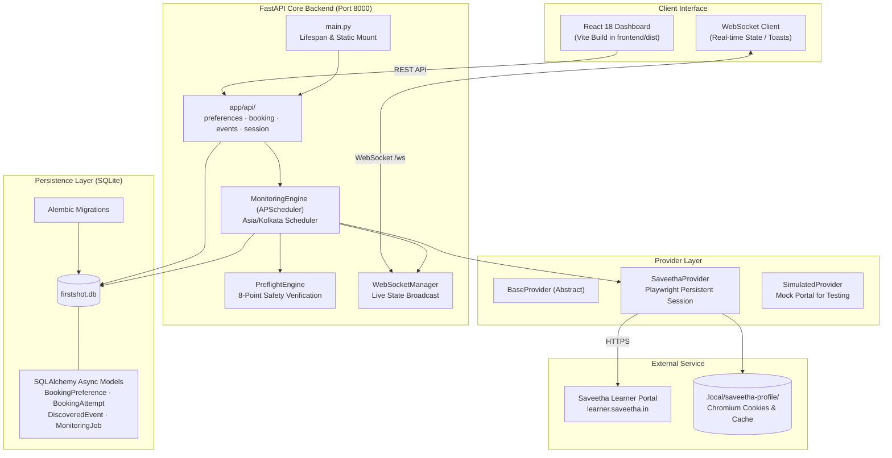
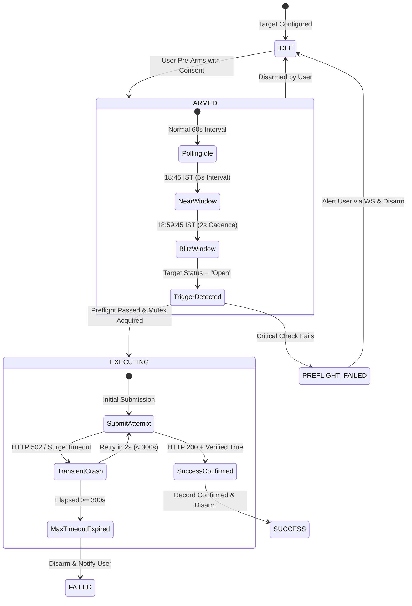

# FirstShot Architecture Reference

> **Version:** 1.0.0  
> **Status:** Production Ready

---

## 1. System Overview

FirstShot is a specialized autonomous booking assistant designed for the Saveetha Learner Portal. It solves the challenge of high-demand assessment slot reservations opening at fixed nightly times (19:00:00 IST) by automating the discovery, status tracking, pre-flight verification, and booking submission with sub-second responsiveness and surge-crash fault tolerance.

### Architecture Diagram

---

## 2. Autonomous Booking Execution State Machine

A target preference traverses a strict sequence of state transitions to prevent premature submission, duplicate booking, or unhandled failures:

---

## 3. Core Engine Components

### 3.1 Adaptive Cadence Polling (`app/services/scheduler.py`)
The `MonitoringEngine` uses APScheduler with timezone `Asia/Kolkata`:
- **Standard Cadence (60s)**: Operates during off-peak hours.
- **Near-Window Cadence (5s)**: Activates between 18:45 and 19:15 IST when target is armed.
- **Blitz-Window Cadence (2s)**: Activates between 18:59:45 and 19:05:00 IST for millisecond slot detection.

### 3.2 8-Point Preflight Verification (`app/services/preflight.py`)
Before executing any submission, `PreflightEngine` verifies:
1. **Session Authentication**: Active cookies on college portal.
2. **Target Slot Existence**: Real matching event card published on portal.
3. **Room, Date & Time Integrity**: Venue and times correspond exactly to configuration.
4. **Session Identifier Resolution**: Accurate numeric or unique session ID.
5. **Purpose Validation**: Non-empty purpose string <= 255 characters.
6. **Pre-Armed Authorization**: Explicit user permission flag set.
7. **Duplicate Prevention**: No prior confirmed attempt for this target.
8. **Monitoring State**: Target is actively tracked.

### 3.3 Surge-Crash Resilience Loop
During peak 19:00 IST traffic, the college portal frequently returns HTTP 502 Bad Gateway or socket timeouts. FirstShot implements:
- **Crash Session Preservation**: `check_session()` treats 5xx codes as server surges rather than credential loss.
- **Continuous 5-Minute Retry Window**: Retries submissions every 2 seconds for up to 300 seconds.

---

## 4. Database Schema

The SQLite schema consists of five primary entities:

| Table | Description |
|---|---|
| `booking_preferences` | User target configurations, arming state, execution status, and preflight records. |
| `booking_attempts` | Audit trail of submission attempts, response messages, retry counts, and duration. |
| `discovered_events` | Cached assessment cards discovered from portal pages. |
| `monitoring_jobs` | Background polling configurations. |
| `notification_logs` | Real-time status change log messages. |

---

## 5. API Surface Summary

| Route | Method | Description |
|---|---|---|
| `/health` | GET | Service health check |
| `/api/preferences/` | GET, POST | List and create booking targets |
| `/api/preferences/from-card` | POST | 1-click target creation from portal event card |
| `/api/preferences/{id}/arm` | PUT | Pre-arm target for autonomous execution |
| `/api/preferences/{id}/disarm` | PUT | Disarm target |
| `/api/preferences/{id}/preflight` | POST | Run 8-point preflight audit on demand |
| `/api/events/` | GET | Query live or cached portal events |
| `/api/events/terms` | GET | List available academic terms |
| `/api/booking/attempts` | GET | List historical submission attempts |
| `/api/session/status` | GET | Check local browser session authentication |
| `/api/session/reauthenticate`| POST | Launch visible browser for portal login |
| `/ws` | WebSocket | Real-time state change and toast notification stream |
