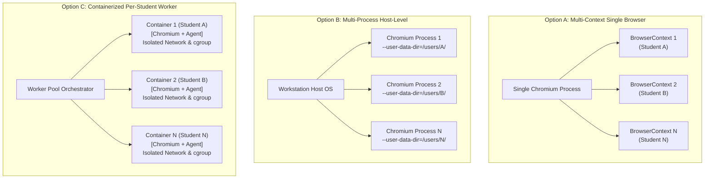
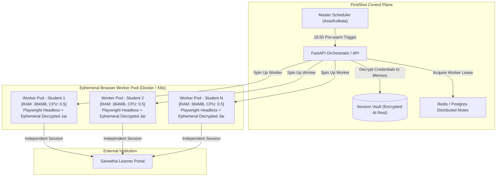

# Multi-User Browser Worker Architecture Evaluation

> **Document:** `docs/BROWSER_WORKER_ARCHITECTURE.md`  
> **Status:** Architecture Design & Feasibility Analysis  
> **Target:** FirstShot Multi-Student Scalable Session Platform  

---

## 1. Architectural Options Evaluation

To support multiple students simultaneously without cross-user interference or credential compromise, three distinct architectural paradigms are evaluated:

---

## 2. In-Depth Comparative Matrix

| Evaluation Dimension | Option A: Playwright BrowserContexts | Option B: Multi-Process Persistent Dirs | Option C: Dedicated Worker Containers |
|---|---|---|---|
| **Security Isolation** | 🔴 **Low**: Shared Chromium heap, memory space, and renderer processes. A zero-day renderer exploit or memory bug can allow Student A to inspect Student B's DOM or cookies. | 🟡 **Medium**: OS process-level boundary with separate PID and user data paths. Vulnerable to local privilege escalation or shared filesystem access bugs. | 🟢 **High**: Kernel namespace, cgroups, network namespace, and optional gVisor / Firecracker virtualization boundary. |
| **Fault Isolation** | 🔴 **Critical Flaw**: If Chromium crashes under 19:00 surge, **all students** crash simultaneously. | 🟢 **Good**: If Process A crashes on a 502 error, Process B continues executing unaffected. | 🟢 **Excellent**: Complete container failure is isolated to that student's sandbox; health-check automatically restarts the pod. |
| **Memory Footprint** | 🟢 **~50 MB** per context + 250 MB base browser process. | 🟡 **~150–250 MB** per student browser process. | 🟡 **~200–300 MB** per student worker container (including Alpine base + Playwright + Python runtime). |
| **Startup / Pre-Arm Latency** | 🟢 **Sub-second (100–300 ms)** to open new tab/context. | 🟡 **1.5–3.0 seconds** to launch full Chromium binary. | 🟡 **2.0–4.0 seconds** cold start (or instant with warm pre-warmed pool). |
| **Persistent Authentication** | 🟡 **Export Required**: Relies on `storageState` JSON dump/restore into memory; profile caches are ephemeral. | 🟢 **Native**: Disk-backed Chromium user-data directory keeps LevelDB, indexedDB, and cookie jars intact. | 🟢 **Encrypted Volume**: Persistent session state stored on encrypted per-user block storage volumes. |
| **Scalability (Single Node)** | High thread count, but dangerous stability at scale. | Limited by OS file descriptors and RAM (~30–40 on 16GB node). | Horizontally scalable across Kubernetes / Docker Swarm nodes. |
| **Operational Complexity** | Very Low (single Python application). | Medium (host process management, zombie process reaping). | High (requires container runtime, orchestration, encrypted volume mounting). |
| **Cost Efficiency** | Lowest server cost. | Moderate server cost. | Predictable, manageable scaling costs. |

---

## 3. Recommended Architecture: Hybrid Tiered Worker Model

> [!CAUTION]
> **Security Caveat**: A Playwright `BrowserContext` must **never** be treated as an operating-system security boundary in a multi-tenant production environment where students' private portal accounts and personal bookings are handled.

### Recommended Strategy:
FirstShot should implement **Option C (Dedicated Containerized Browser Worker Pool)** for multi-tenant production, with **Option B (Multi-Process Host Isolation)** supported for local multi-account development.

### Why this design wins:
1. **Zero Cross-Contamination**: Each student worker executes in its own cgroup, with isolated memory, environment variables, and temporary disk.
2. **Blast-Radius Containment**: If the portal crashes during the 19:00 surge or a Playwright worker hangs on a malformed DOM element, only that individual container is impacted.
3. **Scheduled Resource Allocation**: Browser workers do **not** need to run 24/7. They can remain hibernated in storage and spin up 5 minutes before booking windows (18:55:00 IST) and shut down immediately after execution.

---

## 4. Resource & Capacity Planning (10, 50, 100 Students)

Chromium headless automation has well-documented memory and CPU footprints. The following models plan capacity under simultaneous peak surge (18:59:45–19:05:00 IST):

### 4.1 Per-Worker Profile Sizing
- **Base Container Runtime**: ~50 MB RAM
- **Headless Chromium Instance**: ~180–220 MB RAM
- **Page DOM / Playwright Overhead**: ~50 MB RAM
- **Allocated Safe Limit per Worker**: **384 MB RAM / 0.5 vCPU**
- **Idle / Monitoring Mode**: Container stopped; periodic read monitoring shared or scheduled sequentially.

### 4.2 Scale Projections

| Student Cohort | Concurrency Model | CPU Requirements | RAM Requirements | Storage (Encrypted Sessions) | Recommended Host Specs |
|---|---|---|---|---|---|
| **10 Students** | 10 Concurrent Workers | 5 vCPUs peak | 3.84 GB RAM | ~50 MB total | 4 vCPU, 8 GB RAM VPS |
| **50 Students** | 50 Concurrent Workers | 25 vCPUs peak (or staggered) | 19.2 GB RAM | ~250 MB total | 16 vCPU, 32 GB RAM Dedicated Server |
| **100 Students** | 100 Concurrent Workers | 50 vCPUs peak (or worker queues) | 38.4 GB RAM | ~500 MB total | 2x Nodes (16 vCPU, 32 GB RAM each) |

---

## 5. Infrastructure Cost Estimates

Estimated monthly infrastructure costs for hosting the multi-user worker architecture:

| Tier | Infrastructure Platform | Specification | Est. Monthly Cost | Notes |
|---|---|---|---|---|
| **Tier 1 (1–10 Students)** | Hetzner Cloud / DigitalOcean | 4 vCPU, 8 GB RAM, 80 GB SSD | **\$12 – \$18 / mo** | Single Docker host running isolated containers. Sufficient for small study group. |
| **Tier 2 (10–50 Students)** | Hetzner Dedicated / OVH | 8 Cores (16 Threads), 32 GB RAM | **\$45 – \$65 / mo** | Bare-metal server running K3s or Docker Compose. Excellent surge CPU capacity. |
| **Tier 3 (50–100 Students)**| Managed Kubernetes (Hetzner / DO) | 2x Worker Nodes (8 vCPU, 16GB) + Load Balancer | **\$90 – \$140 / mo** | Auto-scaling worker pods. Pods scale to zero between 19:15 and 18:45 next day. |
| **Serverless Alternative** | AWS ECS Fargate (Scheduled) | 50 Tasks (0.5 vCPU, 1GB) active 15 mins/day | **\$6 – \$10 / mo** | Extremely cost-effective by running containers only during the 15-minute booking window. |

---

## 6. Recommendations & Implementation Guardrails

1. **Phase 1 (Development & Architecture)**: Use **Option B** with unique directories per user: `.local/users/{user_id}/profile/`.
2. **Phase 2 (Staging Multi-User)**: Deploy containerized workers with strict CPU/memory limits and isolated volumes.
3. **Pre-Warming**: For the 19:00 IST surge, worker containers must be pre-warmed at **18:55:00 IST** so that DNS, browser binaries, and session validation are pre-loaded before the blitz window opens.
4. **Pruning**: Terminate and scrub container instances at **19:10:00 IST** to eliminate idle memory consumption and minimize the exposure window of active session handles.
