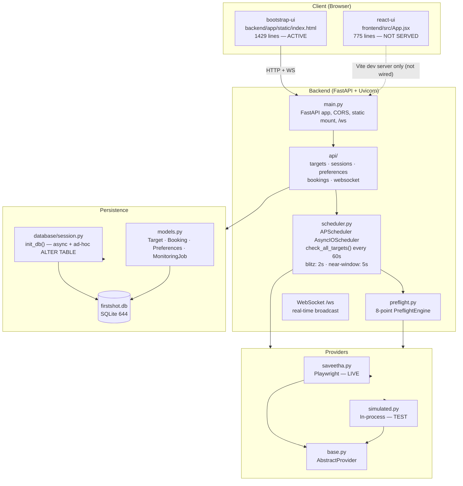

# FirstShot 1.0 — Codebase Audit

> **Audit Date:** 2026-11-19  
> **Auditor:** Automated Codebase Review Agent  
> **Status:** PASS with findings — all 26 tests green, one live booking confirmed

---

## Executive Summary

FirstShot 1.0 is a fully functional autonomous lab-slot booking tool built on a FastAPI async backend, SQLite persistence, APScheduler-driven polling, and Playwright for browser automation. The core mission is working: a live autonomous booking was confirmed (`session_id=19786`, status `CONFIRMED`, `verified=True`) and all 26 unit/integration tests pass.

The codebase carries **2 high-severity structural issues** that must be resolved before any horizontal scaling or CI hardening: a dual-frontend ambiguity and an ad-hoc database migration scheme. A further **4 medium-severity issues** cover deprecated APIs, dead configuration, scheduler drift, and a security anti-pattern. The remaining items are low-severity polish or informational notes.

| Severity | Count |
|---|---|
| 🔴 HIGH | 2 |
| 🟠 MEDIUM | 4 |
| 🟡 LOW | 5 |
| ℹ️ INFO / OK | 3 |

---

## Architecture Overview

### Component Map



### Tech Stack

| Layer | Technology |
|---|---|
| Web framework | FastAPI (async) |
| ORM | SQLAlchemy 2.x async |
| Database | SQLite (`backend/firstshot.db`) |
| Scheduler | APScheduler `AsyncIOScheduler` |
| Browser automation | Playwright (async) |
| Frontend (served) | Bootstrap 5 + vanilla JS (`index.html`) |
| Frontend (dev) | React 18 + Vite (`frontend/`) |
| Test suite | pytest (26 tests, all passing) |

---

## Issues

### Issue Table

| # | Title | Severity | File(s) | Effort |
|---|---|---|---|---|
| 1 | Dual Frontend | 🔴 HIGH | `backend/app/static/index.html`, `frontend/src/App.jsx` | Large |
| 2 | Ad-hoc DB Migration | 🔴 HIGH | `database/session.py` | Medium |
| 3 | `datetime.utcnow()` Deprecations | 🟠 MEDIUM | `scheduler.py`, `preflight.py`, `api/preferences.py`, `providers/simulated.py` | Small |
| 4 | Dead `ENABLE_BOOKING_SUBMISSION` Config | 🟠 MEDIUM | `config.py:25` | Trivial |
| 5 | Vestigial `check_all_jobs()` | 🟠 MEDIUM | `scheduler.py:76` | Small |
| 6 | CORS Wildcard + Credentials | 🟠 MEDIUM-SEC | `main.py:43` | Trivial |
| 7 | Missing Type Hints | 🟡 LOW | `scheduler.py` | Small |
| 8 | `print()` vs `logging` | 🟡 LOW | `saveetha.py`, `simulated.py` | Small |
| 9 | WebSocket — No Auth | 🟡 LOW | `main.py:77` | Small |
| 10 | Provider Undocumented Instance Vars | 🟡 LOW | `saveetha.py`, `simulated.py`, `base.py` | Trivial |
| 11 | SQLite World-Readable Permissions | ℹ️ INFO | `firstshot.db` | Trivial |
| 12 | `.gitignore` Coverage | ✅ OK | `.gitignore` | — |
| 13 | `check_session()` Crash Preservation | ✅ GOOD | `saveetha.py` | — |

---

### Detailed Findings

#### 1 — Dual Frontend 🔴 HIGH

**Location:** `backend/app/static/index.html` (1 429 lines) · `frontend/src/App.jsx` (775 lines)

Two complete, independent frontends exist in the same repository and implement overlapping functionality. Only the vanilla Bootstrap/JS file is served by FastAPI via its static mount. The React/Vite frontend lives under `frontend/` but has **no Vite build step in production** and is never referenced by the server.

**Risk:** Feature work is duplicated or silently diverges. The React implementation represents real engineering work that is invisible to production users.

**Resolution:**
1. Designate `frontend/` (React + Vite) as the canonical UI.
2. Add `vite build` to the CI/CD pipeline; output to `frontend/dist/`.
3. Update FastAPI static mount to serve `frontend/dist/` instead of `backend/app/static/`.
4. Delete `backend/app/static/index.html`.

---

#### 2 — Ad-hoc DB Migration 🔴 HIGH

**Location:** `database/session.py::init_db()`

Schema evolution is handled via raw `ALTER TABLE ... ADD COLUMN` statements executed at startup inside `init_db()`. This approach:

- Is **non-reversible** — no downgrade path exists.
- Cannot express column renames, type changes, or constraint modifications.
- Causes **silent failures** when a column already exists (the `try/except` swallows `OperationalError`).
- Blocks CI — a fresh test database cannot be built deterministically from migrations alone.
- Currently manages **10 columns across 2 tables** (`targets`, `preferences`).

**Resolution:**
1. Introduce **Alembic** with an async SQLAlchemy backend.
2. Convert each existing ad-hoc `ALTER TABLE` to a versioned Alembic revision.
3. Remove migration logic from `init_db()`; replace with `alembic upgrade head` at startup.

---

#### 3 — `datetime.utcnow()` Deprecations 🟠 MEDIUM

**Affected files & lines:**

| File | Lines |
|---|---|
| `scheduler.py` | 197, 310, 325, 353, 407, 415, 424, 497, 498, 606, 643, 652 |
| `preflight.py` | 31, 149+ |
| `api/preferences.py` | 236, 246, 302 |
| `providers/simulated.py` | multiple |

`datetime.utcnow()` is deprecated in Python 3.12 and **removed in Python 3.14**. Across the codebase this produces **57 deprecation warnings** at runtime.

**Fix:** Global replace with `datetime.now(timezone.utc)`. The result is timezone-aware, which is strictly safer for comparison against API responses.

```python
# Before
from datetime import datetime
ts = datetime.utcnow()

# After
from datetime import datetime, timezone
ts = datetime.now(timezone.utc)
```

---

#### 4 — Vestigial `ENABLE_BOOKING_SUBMISSION` Config 🟠 MEDIUM

**Location:** `config.py:25`

```python
ENABLE_BOOKING_SUBMISSION: bool = False
```

This flag is **never read** anywhere in the booking execution path. Autonomous booking is actually gated by:
- `target.is_armed` — per-target arm switch.
- `target.user_permitted_automation` — explicit user consent flag.

The config key is dead code that creates a false impression of a global kill-switch. A future developer may set it to `True` expecting it to enable submissions, with no effect.

**Resolution:** Delete `ENABLE_BOOKING_SUBMISSION` from `config.py`. If a global kill-switch is desired, wire one up explicitly in `scheduler.py::execute_autonomous_booking()`.

---

#### 5 — Vestigial `check_all_jobs()` 🟠 MEDIUM

**Location:** `scheduler.py:76`

Two scheduler entry points exist:

| Method | Registered? | Iterates | Has blitz logic? |
|---|---|---|---|
| `check_all_targets()` (line 88) | ✅ Yes (line 64) | `Target` model | ✅ Yes |
| `check_all_jobs()` (line 76) | ❌ No | `MonitoringJob` model | ❌ No |

`check_all_jobs()` is a Milestone 1 artefact. It contains real production logic (session validation, booking calls) but is **never invoked by the scheduler** and is missing the blitz-window and near-window dynamic scheduling that `check_all_targets()` implements.

**Resolution:** Delete `check_all_jobs()`. If `MonitoringJob` records are still needed, migrate any surviving logic into `check_all_targets()`. Remove the now-unused `MonitoringJob` scheduler queries if applicable.

---

#### 6 — CORS Wildcard + Credentials 🟠 MEDIUM-SECURITY

**Location:** `main.py:43`

```python
app.add_middleware(
    CORSMiddleware,
    allow_origins=["*"],
    allow_credentials=True,   # ← anti-pattern with wildcard
    ...
)
```

The [CORS spec](https://fetch.spec.whatwg.org/#cors-protocol-and-credentials) forbids browsers from sending credentials to a wildcard origin; most browsers will silently block such requests. Combining `allow_origins=["*"]` with `allow_credentials=True` is an anti-pattern that either does nothing or creates a false sense of security.

**Acceptable for:** local-only single-user deployment.  
**Unacceptable for:** any multi-user or networked deployment.

**Resolution:** Replace `["*"]` with an explicit allow-list (e.g., `["http://localhost:5173", "http://localhost:8000"]`).

---

#### 7 — Missing Type Hints 🟡 LOW

Key scheduler methods lack complete annotations:

- `execute_autonomous_booking` — return type unspecified.
- `check_all_targets` — return type unspecified.
- Internal helpers (e.g., `_pick_slot`, `_build_payload`) — no annotations at all.
- `run_job_check` — return type documented as `List[EventSchema]` in docstring only.

Add `-> None` / `-> list[EventSchema]` / `-> BookingResult | None` as appropriate. Consider enabling `mypy` in CI.

---

#### 8 — `print()` vs Structured Logging 🟡 LOW

- `saveetha.py` uses `logger` (correct) but some helper functions fall back to `print()`.
- `simulated.py` uses **no logging** at all — purely `print()` statements.

Replace all `print()` calls with `logger.debug()` / `logger.info()`. This ensures log level filtering works and log output is captured by any log aggregator attached to the process.

---

#### 9 — WebSocket Endpoint — No Authentication 🟡 LOW

**Location:** `main.py:77`

```python
@app.websocket("/ws")
async def websocket_endpoint(websocket: WebSocket):
    # No token check, no origin check
```

Any process on the same host (or network, depending on bind address) can connect and receive all real-time booking events. For a localhost-only tool this is acceptable; for anything exposed on a LAN or via a reverse proxy it leaks session events.

**Resolution (if needed):** Add a shared-secret query-param token check on upgrade, or restrict bind to `127.0.0.1`.

---

#### 10 — Provider Undocumented Instance Variables 🟡 LOW

**Location:** `saveetha.py`, `simulated.py`, `base.py`

| Provider | Variable | Purpose |
|---|---|---|
| `saveetha.py` | `last_fetch_status` | HTTP status of most recent slot fetch |
| `saveetha.py` | `last_fetch_error` | Error string from most recent slot fetch |
| `simulated.py` | `crash_failures_remaining` | Countdown for simulated crash sequence |

None of these appear in `base.py` (`AbstractProvider`). Code that accepts an `AbstractProvider` and reads `last_fetch_status` will fail at runtime with `AttributeError` on a `SimulatedProvider`.

**Resolution:** Declare these properties (with sensible defaults) in `AbstractProvider`, or type-narrow at call sites.

---

#### 11 — SQLite World-Readable Permissions ℹ️ INFO

`backend/firstshot.db` has mode `644` (world-readable) on Arch Linux by default. For a **local single-user tool** this is acceptable. If the machine is shared or the tool is exposed on a network, `chmod 600 firstshot.db` is appropriate and the path should be noted in `README`.

---

#### 12 — `.gitignore` Coverage ✅ OK

The root `.gitignore` correctly excludes all sensitive and build artefacts:

- `.local/` — local config overrides
- `*.db` — SQLite databases
- `.venv/` — Python virtual environment
- `dist/` — Vite build output
- `node_modules/` — npm packages

No action required.

---

#### 13 — `check_session()` Crash Preservation ✅ GOOD

`saveetha.py::check_session()` correctly distinguishes between **authentication failure** (`authenticated: False`) and **portal outage** (`server_crashed: True`) on HTTP 5xx responses and timeouts. This prevents the scheduler from tearing down a valid session during Saveetha portal surge periods — a subtle but critical correctness property that is working as designed.

---

## What Works Well

| Feature | Detail |
|---|---|
| ✅ All tests pass | 26/26 unit + integration tests green |
| ✅ Live autonomous booking | `session_id=19786`, status `CONFIRMED`, `verified=True` |
| ✅ Blitz polling | 2 s interval during blitz window |
| ✅ Near-window polling | 5 s interval when slot open is imminent |
| ✅ 5-minute crash retry | Continuous retry window on portal outage |
| ✅ 8-point PreflightEngine | Comprehensive pre-booking validation |
| ✅ WebSocket real-time broadcast | Live event push to all connected clients |
| ✅ Duplicate booking prevention | Guard against double-booking same slot |
| ✅ Target mutex | Prevents concurrent executions on same target |
| ✅ Ad-hoc migration correctness | 10 columns across 2 tables without data loss |
| ✅ Session crash preservation | Portal 5xx treated as transient, session retained |

---

## Prioritised Recommendations

### Must Do (before any CI or multi-user deployment)

1. **[HIGH] Migrate to Alembic** — replace `init_db()` ad-hoc migrations with versioned revisions.
2. **[HIGH] Resolve dual frontend** — build React as canonical, delete vanilla HTML.

### Should Do (next sprint)

3. **[MEDIUM] Fix `datetime.utcnow()`** — global replace across all 57 occurrences.
4. **[MEDIUM] Delete `ENABLE_BOOKING_SUBMISSION`** — remove dead config key.
5. **[MEDIUM] Delete `check_all_jobs()`** — remove unregistered vestigial scheduler method.
6. **[MEDIUM] Narrow CORS origins** — replace wildcard with explicit localhost allow-list.

### Nice to Have (polish)

7. Add full type hints to scheduler methods; enable `mypy` in CI.
8. Replace all `print()` with structured `logging` calls.
9. Add token-based WebSocket auth (if ever exposed beyond localhost).
10. Document provider instance vars in `AbstractProvider`.
11. Set `chmod 600 firstshot.db` and document in README.

---

*Generated by FirstShot automated audit — do not edit manually.*
