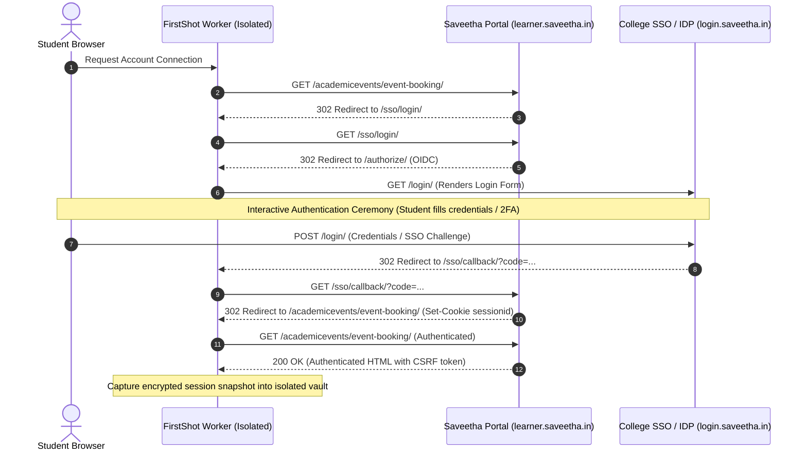

# Saveetha Portal Authentication & Institutional Authorization Investigation

> **Document:** `docs/PORTAL_AUTH_INVESTIGATION.md`  
> **Status:** Architecture Investigation & Implementation Design  
> **Scope:** Multi-User Architecture Analysis for Saveetha Learner Portal  
> **Author:** FirstShot Systems Engineering Group  

---

## 1. Executive Summary

As FirstShot evaluates evolving from a single-user personal automation engine into a multi-student platform, every student on the Saveetha portal (`https://learner.saveetha.in`) must operate within a strictly isolated, unshared authentication envelope.

This document investigates the portal's authentication flow, session dynamics, cookie structures, anti-automation postures, and institutional authorization requirements based on technical reconnaissance conducted during Milestones 1–3 and network trace analysis.

> [!IMPORTANT]
> **No Credentials or Bypasses**: FirstShot does not store plaintext student passwords, does not attempt to circumvent CAPTCHAs or institutional authentication controls, and does not conduct unauthorized access. Until formal institutional authorization is established, all multi-user automated booking execution must remain disabled by default.

---

## 2. Technical Investigation of the Authentication Flow



### 2.1 Login Workflow & OIDC / SSO Federation
The portal does not implement local database authentication on the booking route. Instead, it employs an OpenID Connect (OIDC) federation:
1. **Unauthenticated Entry**: An unauthenticated `GET` request to `/academicevents/event-booking/` yields an `HTTP 302 Found` with `Location: /sso/login/`.
2. **SSO Redirection**: `/sso/login/` evaluates client headers and issues an `HTTP 302 Found` to `/authorize/`, passing `client_id`, `response_type=code`, and `redirect_uri=https://learner.saveetha.in/sso/callback/`.
3. **Interactive Login Screen**: The authorization endpoint serves an HTML form (`/login/`) containing username, password, and institutional branding.
4. **Token Exchange**: Upon valid interactive submission, the SSO identity provider issues an authorization code redirected to `/sso/callback/`.
5. **Session Inception**: The Django application layer validates the authorization token with the back-channel SSO service and sets session cookies via `Set-Cookie`.

### 2.2 Cookie Architecture & Token Mechanics
Based on network inspection and Playwright profile extraction, the Saveetha portal relies on standard Django session architecture:

| Cookie Name | Domain | Flags | Purpose | Expiration |
|---|---|---|---|---|
| `sessionid` | `.saveetha.in` | `HttpOnly`, `Secure`, `SameSite=Lax` | Primary Django session store key referencing user ID, active role, and session state. | Sliding 14–30 days or explicit logout. |
| `csrftoken` | `.saveetha.in` | `Secure`, `SameSite=Lax` | CSRF protection token matching `csrfmiddlewaretoken` embedded in POST forms. | 1 year (standard Django default). |
| `messages` | `.saveetha.in` | `HttpOnly`, `Secure` | Transient cookie storing flash notifications (e.g., booking confirmations/errors). | Session-only (deleted upon consumption). |

### 2.3 Storage Mechanisms (Local & Session Storage)
- **Local Storage (`localStorage`)**: Used primarily by frontend UI components (Bootstrap / SB Admin) to store UI theme preferences and sidebar collapsed state (`sb|sidebar-toggle`). No JWT tokens or authentication bearer tokens are stored in `localStorage`.
- **Session Storage (`sessionStorage`)**: Transient browser state for active tab navigation. No sensitive security keys are stored here.
- **Implication**: Complete browser state can be serialized or restored by persisting the cookie jar and local database cache, provided that user-agent fingerprinting and IP binding are handled consistently.

### 2.4 CSRF Protection Requirements
The Saveetha portal enforces strict Django CSRF protection on all state-altering endpoints (`POST /academicevents/event-booking/`):
- Form submissions require a hidden field: `<input type="hidden" name="csrfmiddlewaretoken" value="...">`.
- The value must match the token provided in the `csrftoken` cookie.
- Submissions failing this match return `HTTP 403 Forbidden` (`CSRF verification failed. Request aborted.`).
- **FirstShot Requirement**: Any isolated browser session must read the current DOM's `csrfmiddlewaretoken` or the cookie value dynamically prior to submitting booking requests.

### 2.5 Session Expiration & Invalidation Dynamics
- **Inactivity Timeout**: The portal session expires after extended periods of inactivity (observed between 7 to 14 days without access).
- **Explicit Logout**: Accessing `/logout/` or `/sso/logout/` invalidates the server-side session in the college database and issues `Set-Cookie: sessionid=deleted; Max-Age=0`.
- **Server-Side Revocation**: System maintenance or term rollover invalidates all active student sessions simultaneously.
- **Transient Failures vs. Expiration**: As proven in Milestone 3, HTTP 500/502/504 errors during peak 19:00 IST surges **do not** indicate session expiration. The session remains valid even when the portal returns temporary gateway errors.

### 2.6 Concurrent Login Behaviour
- **Observed Behavior**: Logging into the portal from a new physical device does not immediately terminate existing sessions. However, simultaneous POST requests from disparate IP blocks to the booking endpoint may trigger rate-limiting or anti-scraping blocks.
- **Multi-Tenant Risk**: If two FirstShot workers were to access the portal using the same student account concurrently, race conditions and session desynchronization would occur.

### 2.7 Existing Playwright Integration in FirstShot
Currently, `SaveethaProvider` in `backend/app/providers/saveetha.py` manages a single Chromium instance:
- It launches with `launch_persistent_context(user_data_dir=...)`.
- It relies on a local disk directory: `.local/saveetha-profile/`.
- It executes both read queries (`get_events`) and booking form fills (`submit_booking`) inside the same profile.
- **Limitation**: This model is strictly single-tenant. Running multiple students concurrently on this architecture would corrupt the shared browser cache and cause severe cross-student data leakage.

---

## 3. Institutional Authorization & Compliance Investigation

To deploy FirstShot as a multi-user service for multiple students, clear institutional boundaries must be established.

### 3.1 Portal Capabilities & API Availability
- **Official Public API**: **None**. The portal offers no public GraphQL or REST API for academic booking.
- **Approved Third-Party Integrations**: **None**. The college has not published an OAuth2 application registry or developer integration portal for student-built tools.
- **Web Interface Only**: All interactions are designed for standard desktop/mobile web browsers via HTML rendering.

### 3.2 Terms of Service & Acceptable Use Constraints
Academic institutions typically enforce Acceptable Use Policies (AUP) covering campus IT infrastructure. Key considerations:
1. **Automated Submission Restrictions**: Many institutional portals prohibit programmatic submission, rapid scraping, or automated form submission that creates artificial load or bypasses human user workflows.
2. **Credential Sharing**: Students are strictly prohibited from sharing institutional portal passwords, multi-factor tokens, or session tokens with third parties or central servers.
3. **Denial of Service Concerns**: Ramping automated checks to high frequencies across hundreds of students simultaneously at 18:59:59 IST could constitute an accidental Distributed Denial of Service (DDoS) against the college server.

### 3.3 Known vs. Unresolved Permissions

```
+---------------------------------------------------------------------------------------+
| STATUS OF INSTITUTIONAL AUTHORIZATION                                                 |
+---------------------------------------------------------------------------------------+
| [KNOWN]       - Portal uses Django Session + OIDC authentication.                     |
| [KNOWN]       - High traffic surge causes HTTP 502/504 at 19:00 IST daily.            |
| [KNOWN]       - Students have legitimate academic entitlement to book slots.          |
+---------------------------------------------------------------------------------------+
| [UNRESOLVED]  - Formal permission to automate booking on behalf of students.          |
| [UNRESOLVED]  - Documented server rate limits (requests per minute per IP / student). |
| [UNRESOLVED]  - Permissibility of cloud-hosted multi-tenant session proxies.          |
| [UNRESOLVED]  - Institutional API roadmap or developer partnership.                  |
+---------------------------------------------------------------------------------------+
```

### 3.4 Regulatory & Architectural Policy
Until formal institutional consent or an official student automation agreement is executed:
1. **Multi-User Real Booking Disabled**: The multi-user engine must operate exclusively in **OBSERVE** mode or simulated staging mode.
2. **Zero Credential Custody**: FirstShot must never collect, transmit, or store student passwords. Authentication must occur via delegated, interactive sessions where the student inputs credentials directly into an isolated browser interface.
3. **Strict Rate Limiting**: The platform must enforce global and per-student rate limits to avoid stressing college infrastructure.
