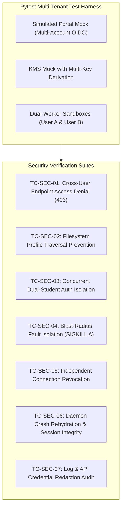

# FirstShot Multi-Tenant Session Isolation & Security Test Plan

> **Document:** `docs/SESSION_ISOLATION_TEST_PLAN.md`  
> **Status:** Verification & Testing Specification  
> **Target:** Automated Quality & Security Assurance for Multi-User Sessions  

---

## 1. Scope & Test Objectives

This document establishes a rigorous automated test suite designed to verify that the FirstShot multi-user browser architecture provides cryptographic, process, and memory isolation between different students.

Every security invariant specified in `docs/SESSION_SECURITY_DESIGN.md` and `docs/WORKER_LIFECYCLE.md` is mapped to an automated verification case using simulated portal harnesses.



---

## 2. Test Cases & Verification Procedures

### TC-SEC-01: Cross-User Endpoint Access Denial
- **Objective**: Verify that Student A cannot view, query, arm, or modify Student B's connection or target preferences via API calls.
- **Setup**:
  - Provision Student A (`user_id = "usr_001"`, `conn_id = "conn_aaa"`).
  - Provision Student B (`user_id = "usr_002"`, `conn_id = "conn_bbb"`).
- **Execution**:
  1. Authenticate HTTP client as Student A (JWT A).
  2. Attempt `GET /api/connections/conn_bbb`.
  3. Attempt `PUT /api/preferences/target_b/arm` with JWT A.
  4. Attempt `DELETE /api/connections/conn_bbb` with JWT A.
- **Pass Criteria**:
  - All unauthorized requests return `HTTP 404 Not Found` or `HTTP 403 Forbidden`.
  - Zero metadata regarding Student B's target room, date, or identity is leaked in error response bodies.

---

### TC-SEC-02: Filesystem & Profile Directory Isolation
- **Objective**: Ensure Student A's worker process cannot read Student B's temporary profile directory or encryption key.
- **Setup**:
  - Worker A running under sandbox with assigned path `/tmp/workers/conn_aaa/`.
  - Worker B running under sandbox with assigned path `/tmp/workers/conn_bbb/`.
- **Execution**:
  1. Execute a probe script from inside Worker A's runtime attempting to list `/tmp/workers/conn_bbb/`.
  2. Attempt to read `/proc/{worker_b_pid}/environ` and `/proc/{worker_b_pid}/mem`.
- **Pass Criteria**:
  - Filesystem access denied (`EACCES: Permission denied`).
  - Process inspection denied by Linux PID namespace separation.

---

### TC-SEC-03: Concurrent Dual-Student Authentication
- **Objective**: Verify that two students can authenticate with their respective portal accounts simultaneously without session desynchronization or cross-talk.
- **Setup**:
  - Simulated Portal initialized with accounts `student_1@saveetha.in` and `student_2@saveetha.in`.
- **Execution**:
  1. Launch Worker A and Worker B concurrently.
  2. Worker A logs into `student_1`; Worker B logs into `student_2`.
  3. Both workers capture `storageState` and encrypt payloads into database.
  4. Worker A queries `/api/events/`; Worker B queries `/api/events/`.
- **Pass Criteria**:
  - Worker A's session reflects `student_1` profile only.
  - Worker B's session reflects `student_2` profile only.
  - No cookie values are shared between the two contexts.

---

### TC-SEC-04: Blast-Radius Fault Isolation (Worker Crash Resilience)
- **Objective**: Prove that an unhandled crash or Out-Of-Memory (OOM) event in Student A's worker does not disrupt Student B's active monitoring or booking attempt.
- **Setup**:
  - Worker A and Worker B both actively monitoring slots at 18:59:58 IST.
- **Execution**:
  1. Inject an abrupt `kill -9` or memory spike into Worker A (`worker_a_pid`).
  2. Measure Worker B's execution timing, network socket, and booking execution.
- **Pass Criteria**:
  - Worker A enters `WORKER_CRASHED` and self-heals in the background.
  - Worker B completes its slot check and submission cycle with zero dropped frames, zero latency penalty, and zero socket disconnections.

---

### TC-SEC-05: Independent Connection Revocation & Crypto-Shredding
- **Objective**: Verify that revoking or deleting Student A's connection does not impact Student B and permanently eliminates Student A's session access.
- **Execution**:
  1. Invoke `POST /api/connections/conn_aaa/revoke`.
  2. Verify Worker A is killed immediately.
  3. Verify `user_connections.session_payload_encrypted` for `conn_aaa` is `NULL`.
  4. Attempt to decrypt Student A's session using the KMS master key.
  5. Verify Worker B continues operating normally without disruption.
- **Pass Criteria**:
  - Student A's session is completely unrecoverable (cryptographic erasure confirmed).
  - Student B's session remains `HEALTHY` and functional.

---

### TC-SEC-06: Daemon Crash Rehydration & Session Integrity
- **Objective**: Ensure that a complete backend server restart does not mix, leak, or corrupt stored student sessions.
- **Execution**:
  1. Store 10 active student connections in SQLite / PostgreSQL.
  2. Send `SIGTERM` to the FastAPI backend service.
  3. Restart the service and trigger health checks across all 10 connections.
- **Pass Criteria**:
  - All 10 connections rehydrate with their original `user_id` bindings.
  - Every worker context restores its exact individual cookie jar.
  - Zero session crossover detected across all 10 tenants.

---

### TC-SEC-07: Log & API Credential Redaction Audit
- **Objective**: Guarantee that cookies, session hashes, CSRF tokens, and passwords are never emitted in plaintext anywhere in logs or API responses.
- **Execution**:
  1. Run full test suite under `DEBUG` log level capturing stdout, stderr, and file logs.
  2. Inspect all HTTP response bodies from endpoints `/api/session/*`, `/api/connections/*`, and `/api/booking/*`.
  3. Execute automated regex scanners searching for:
     - `sessionid=[a-zA-Z0-9_-]+`
     - `csrftoken=[a-zA-Z0-9_-]+`
     - `Cookie: .*`
     - `Set-Cookie: .*`
- **Pass Criteria**:
  - 100% of scanned logs and API bodies match redaction patterns. Zero raw cookie values detected.

---

## 3. Test Automation Execution Framework

These tests are implemented in `backend/app/tests/test_multi_tenant_isolation.py` using standard pytest and pytest-asyncio, ensuring that every CI build validates tenant boundaries prior to deployment:

```bash
cd backend && pytest app/tests/test_multi_tenant_isolation.py -v
```
