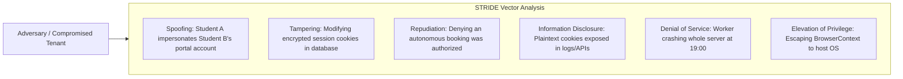

# FirstShot Multi-User Session Security & Encryption Architecture

> **Document:** `docs/SESSION_SECURITY_DESIGN.md`  
> **Status:** Security Specification & Threat Model  
> **Scope:** Cryptographic Protection, Access Control & Multi-Tenant Session Isolation  

---

## 1. Core Session Isolation Model

In a multi-student FirstShot deployment, authentication sessions represent high-value institutional identities. A security boundary breach could expose another student's assessment schedule, allow unauthorized bookings, or leak institutional access cookies.

### 1.1 Structural Isolation Invariants
Every registered portal connection strictly enforces eight invariants:

1. **Unique Connection ID**: Identified by an immutable UUIDv4 (`conn_xxxxxxxx-xxxx-xxxx-xxxx-xxxxxxxxxxxx`), decoupled from student roll numbers or usernames.
2. **Strict User Binding**: Each connection belongs to exactly one `user_id`. Cross-user querying is forbidden at the database query layer via tenant scoping.
3. **Dedicated Physical / Filesystem Boundary**: No two users ever share a browser user data directory, storage state file, or browser process.
4. **Independent Lifecycle FSM**: User A's session health, connection state, or token expiration has zero coupling with User B's state.
5. **Session Health & Heartbeats**: Passive, non-intrusive health checks track authentication freshness without logging user identity.
6. **Expiration Tracking**: Client sessions enforce both local platform TTLs and portal cookie expiry validation.
7. **Immediate Revocation & Crypto-Shredding**: Revoking a connection destroys the underlying encryption keys, immediately rendering persisted snapshots unreadable.
8. **Zero-Knowledge Frontend API**: Cookies, storage state JSON, session hashes, and portal tokens are **never** returned across HTTP APIs or WebSocket payloads. The frontend receives only boolean flags (`authenticated: true/false`, `last_checked_at`, `status_message`).

```
+---------------------------------------------------------------------------------+
| SECURITY BOUNDARY: TENANT ENVELOPE                                             |
|                                                                                 |
|  [Student A Frontend]                                                           |
|          | (JWT Auth: User A)                                                   |
|          v                                                                      |
|  +---------------------------------------------------------------------------+  |
|  | FirstShot API Gateway (Tenant Isolation Middleware)                       |  |
|  | - Rejects any query where connection.user_id != auth.user_id              |  |
|  | - Strips all sensitive credentials from serialization responses           |  |
|  +---------------------------------------------------------------------------+  |
|          |                                                                      |
|          v                                                                      |
|  +---------------------------------------------------------------------------+  |
|  | Session Vault Service                                                     |  |
|  | - Master Key (KMS / Vault) -> Derives per-user Key: KDF(MK, user_id)     |  |
|  | - AES-256-GCM Decryption -> Ephemeral Memory Only                        |  |
|  +---------------------------------------------------------------------------+  |
|          |                                                                      |
|          v                                                                      |
|  +---------------------------------------------------------------------------+  |
|  | Isolated Worker Sandbox (cgroup / container / PID namespace)              |  |
|  | - Chromium instance for Student A ONLY                                     |  |
|  | - RAM-only mount (/dev/shm) for decrypted session cookies                |  |
|  +---------------------------------------------------------------------------+  |
+---------------------------------------------------------------------------------+
```

---

## 2. Secure Session Persistence: At-Rest Encryption & Key Management

### 2.1 Encryption Standard (AES-256-GCM Envelope Encryption)
Session state artifacts (cookie jars, local storage caches, and Playwright session snapshots) are never written to disk in plaintext.

- **Algorithm**: **AES-256-GCM** (Galois/Counter Mode).
  - Provides authenticated encryption with associated data (AEAD).
  - Detects tampering, bit-flipping, or database truncation attacks.
- **Key Derivation (Envelope Encryption)**:
  - **Master Key (KEK)**: Held outside the database in an external Key Management Service (AWS KMS, GCP Cloud KMS, HashiCorp Vault, or environment-injected HSM key).
  - **Data Encryption Key (DEK)**: Generated uniquely per student connection:
    $$\text{DEK} = \text{HKDF-SHA256}(\text{MasterKey}, \text{Salt}=\text{user\_id}, \text{Info}=\text{connection\_id})$$
  - Each session archive is encrypted with a unique 96-bit random initialization vector (IV / Nonce) and authenticated using a 128-bit authentication tag.

### 2.2 Key & Database Separation
- The application database (`firstshot.db` or PostgreSQL) stores only **ciphertext blobs** (`session_payload_encrypted`), the random `nonce`, and key metadata (key version, algorithm).
- The decryption key **never resides in the database**. Even in the event of an unauthenticated SQL dump or backup leak, the session cookies cannot be decrypted without the external KMS key.

### 2.3 Storage State vs. Persistent User Data Directory

| Dimension | Playwright `storageState` JSON | Persistent User Data Directory |
|---|---|---|
| **What is Stored** | Serialized cookies, origins, and localStorage items in a compact JSON document (~5 KB). | Complete Chromium profile: LevelDB, cache, GPU caches, IndexedDB, History (~40–80 MB). |
| **Encryption at Rest** | 🟢 **Trivial**: Single compact JSON string encrypted via AES-256-GCM directly into a database column or vault blob. | 🔴 **Complex**: Requires block-level volume encryption (LUKS) or encrypting hundreds of individual SQLite/LevelDB files. |
| **Restoration Speed** | 🟢 **Ultra-fast (<50 ms)** to inject into a fresh in-memory Playwright context. | 🟡 **Slow (1–2 seconds)** to mount, initialize locks, and check file integrity. |
| **Browser Fingerprint Fidelity** | 🟡 Standardized browser defaults with injected cookie jar. | 🟢 Exact persistent browser state across runs. |
| **Recommendation** | 🟢 **PRIMARY**: Use encrypted `storageState` for persistent vault storage. | 🟡 **LOCAL DEV ONLY**: Use persistent directories for local single-user CLI runs. |

---

## 3. Threat Model (STRIDE Methodology)

An evaluation of threats targeting the multi-tenant session architecture:



### STRIDE Countermeasures:
1. **Spoofing**:
   - *Mitigation*: Hard tenant filtering on every endpoint. API queries verify `UserConnection.user_id == current_authenticated_user.id`. Worker creation validates ownership before decrypting tokens.
2. **Tampering**:
   - *Mitigation*: AES-256-GCM authentication tags guarantee that any modified ciphertext is rejected with a cryptographic authentication exception prior to browser injection.
3. **Repudiation**:
   - *Mitigation*: The `booking_attempts` table records cryptographically auditable submission logs including timestamp, target session ID, preflight hash, and explicit consent check.
4. **Information Disclosure**:
   - *Mitigation*: `SessionStatusResponse` and all API schemas explicitly omit cookie values. Strict log redaction masks any header matching `Cookie`, `Set-Cookie`, `sessionid`, or `csrfmiddlewaretoken`.
5. **Denial of Service**:
   - *Mitigation*: Containerized worker cgroups limit memory to 384 MB and CPU to 0.5 cores. A memory leak or infinite loop in Worker A is killed by the OS kernel OOM killer without affecting Worker B.
6. **Elevation of Privilege**:
   - *Mitigation*: Workers execute as an unprivileged user (`uid: 10001, gid: 10001`) with dropped Linux capabilities (`--cap-drop=ALL`), `--no-sandbox` isolated inside container namespaces, and read-only root filesystems.

---

## 4. Deletion & Revocation Workflows (Cryptographic Erasure)

When a student chooses to disconnect their Saveetha portal account or delete their FirstShot profile:

1. **Active Worker Termination**: If an isolated browser process is running for that connection, a SIGTERM (followed by SIGKILL after 3 seconds) is issued.
2. **Ephemeral Memory Scrubbing**: Any decrypted cookies resident in worker memory or `/dev/shm` tmpfs mounts are zeroed (`shred`).
3. **Cryptographic Erasure (Crypto-Shredding)**: The connection's unique derived key or key reference is permanently deleted from the vault. Even if backup snapshots of the database exist on disk, the ciphertext becomes permanently unrecoverable.
4. **Database Record Nullification**: The `session_payload_encrypted` field is overwritten with `NULL`, and the connection status transitions to `REVOKED`.
5. **Institutional Session Termination**: A final background request accesses `https://learner.saveetha.in/logout/` to invalidate the server-side session in the college database.
