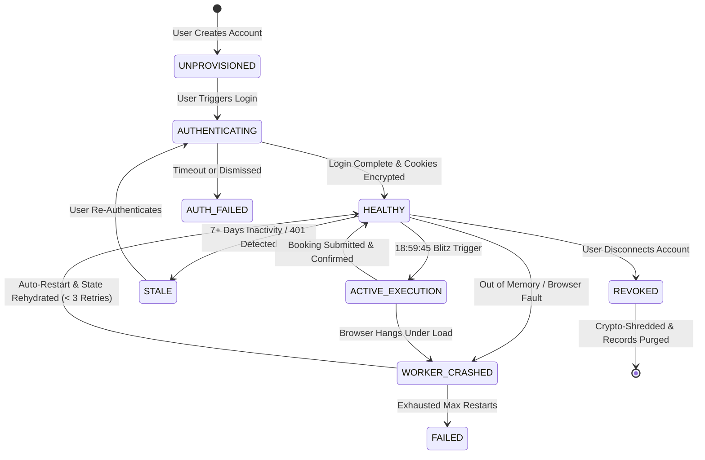
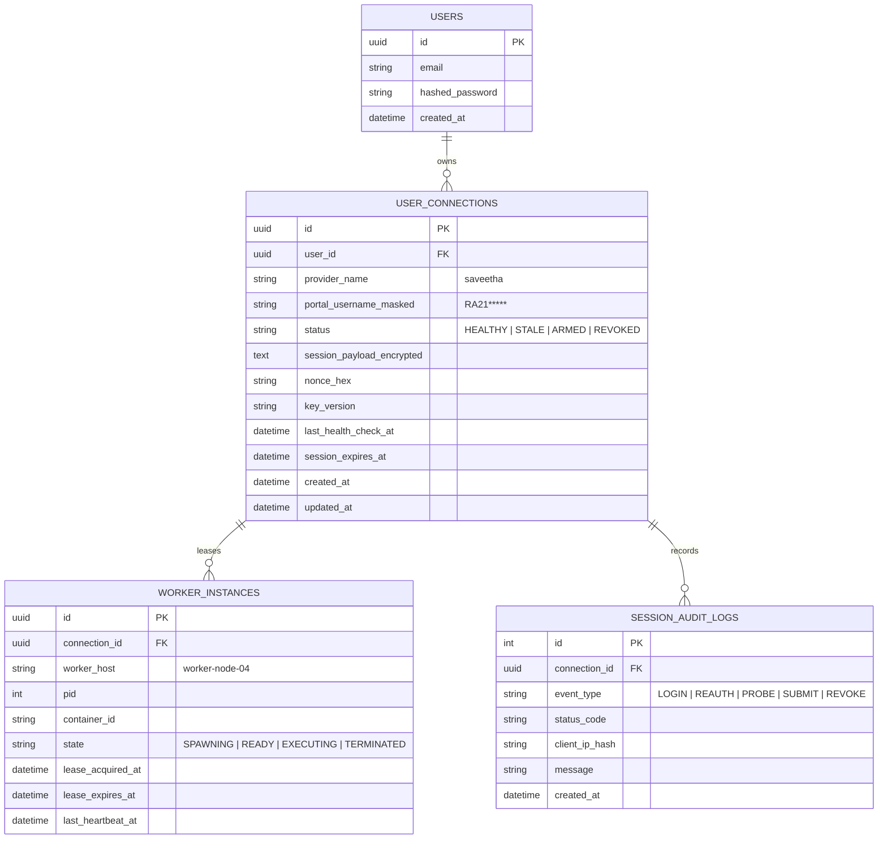

# FirstShot Multi-User Browser Worker Lifecycle & Concurrency Control

> **Document:** `docs/WORKER_LIFECYCLE.md`  
> **Status:** Implementation Design & FSM Specification  
> **Scope:** Process Orchestration, Health Monitoring, Concurrency Locks & Database Schema  

---

## 1. Worker Lifecycle State Machine

A multi-user browser worker manages the end-to-end lifecycle of an isolated portal session. The state machine guarantees that every user session progresses through deterministic states with clear error boundaries:

---

## 2. Worker Lifecycle Operations

### 2.1 Provisioning an Isolated Worker
1. **Trigger**: An authorized FirstShot user requests a Saveetha portal connection or the master scheduler triggers a pre-warmed execution window (18:55 IST).
2. **Resource Allocation**: The orchestrator assigns an ephemeral container or dedicated sandbox process:
   - Sets unique PID / network namespace.
   - Allocates dedicated in-memory tmpfs mount at `/dev/shm/firstshot-worker-{connection_id}`.
   - Enforces 384 MB RAM and 0.5 CPU limits.
3. **Identity Binding**: Worker initializes with environment variable `CONNECTION_ID=conn_xxxx` and tenant identity `USER_ID=usr_xxxx`.

### 2.2 Interactive Authentication Session (Zero Credential Custody)
Because FirstShot **never** collects or stores student passwords:
1. The orchestrator opens a delegated interactive session (via a secure WebRTC / VNC remote display pipe or local visible browser window for desktop users).
2. The student interacts with the college SSO interface directly inside the isolated frame.
3. The worker listens passively for the post-authentication redirect to `https://learner.saveetha.in/academicevents/event-booking/`.
4. Upon successful landing, the worker captures the Playwright `storageState` (cookies + origin storage), encrypts it via AES-256-GCM using the user's derived key, persists the ciphertext into `user_connections`, and terminates the interactive display stream.

### 2.3 Health Verification (Passive Heartbeats)
To avoid unnecessary network traffic or triggering anti-bot protections:
- **Interval**: Every 4 hours (idle) or upon target arming.
- **Probe Method**: Worker issues a lightweight HTTP `HEAD` or `GET` request using the saved cookies to `https://learner.saveetha.in/academicevents/event-booking/`.
- **Classification**:
  - `HTTP 200`: State = `HEALTHY`.
  - `HTTP 302` to `/login/` or `HTTP 401/403`: State = `STALE` (triggers re-auth notification to student).
  - `HTTP 500/502/503/504`: State = `SURGE_DEGRADED` (retains session; does not mark stale).

### 2.4 Resuming an Authorized Session
1. Before an execution window (18:55:00 IST), the scheduler identifies armed targets for Student A.
2. The orchestrator pulls `session_payload_encrypted` from the database.
3. The vault service decrypts the payload in memory into a temporary `storageState` JSON structure.
4. The worker launches a headless Chromium instance with `storage_state=decrypted_json`.
5. Worker verifies that session cookies are live and holds an active page handle in standby.

### 2.5 Crash Recovery & Self-Healing
- If a browser process crashes during the 19:00 IST surge (e.g. host resource pressure or Playwright pipe disconnection), the orchestrator intercepts the exit code.
- Because persistent state is saved in the database vault, the orchestrator immediately provisions a fresh worker container, re-injects the session payload, and resumes monitoring within **<2.5 seconds**.
- An exponential backoff circuit-breaker halts restarts after 3 consecutive failures within 60 seconds to prevent resource exhaustion.

### 2.6 Account Disconnection & Secure Deletion
- **User Action**: Student clicks "Disconnect College Account" in the dashboard.
- **Procedure**:
  1. Worker aborts any in-flight requests and closes Chromium contexts.
  2. Temporary directory `/dev/shm/firstshot-worker-{connection_id}` is wiped.
  3. Encryption key for this connection is deleted from the KMS / key derivation map.
  4. Database record is updated to `status='REVOKED'`, and encrypted session fields are set to `NULL`.
  5. An asynchronous revocation request hits `/logout/` on the college portal to invalidate server-side session tables.

---

## 3. Database Schema for Multi-User Session Management

To support multi-tenancy, FirstShot introduces three structured tables:

---

## 4. Concurrency Control: Mutual Exclusion & Anti-Race Locks

### 4.1 The Split-Brain Session Danger
If two worker instances simultaneously access the same student's portal session:
- Simultaneous POST requests will submit duplicate booking attempts or conflict on CSRF tokens.
- Saveetha's server session might desynchronize, forcing an abrupt logout.

### 4.2 Distributed Lease Mechanism (Advisory Mutex)
To guarantee that **at most one** worker process can hold an active session handle for a student at any time:

1. **Distributed Mutex Key**:
   $$\text{LockKey} = \text{"lock:worker:connection:"} + \text{connection\_id}$$
2. **Lease Acquisition with TTL**:
   - Before launching Chromium, a worker must acquire a lease with a 30-second TTL (using Redis `SET lock:worker:{conn_id} {worker_uuid} NX EX 30` or PostgreSQL `pg_try_advisory_lock`).
   - If the lock is already held, the new worker terminates immediately with `CONCURRENT_WORKER_BLOCKED`.
3. **Heartbeat Lock Renewal**:
   - The active worker sends a renewal heartbeat every 10 seconds extending the TTL to 30 seconds.
4. **Failsafe Release & Zombie Pruning**:
   - If a worker dies ungracefully (e.g. host kernel panic), the lease expires automatically in 30 seconds, allowing the recovery orchestrator to claim the lease without deadlocking the student's profile.
